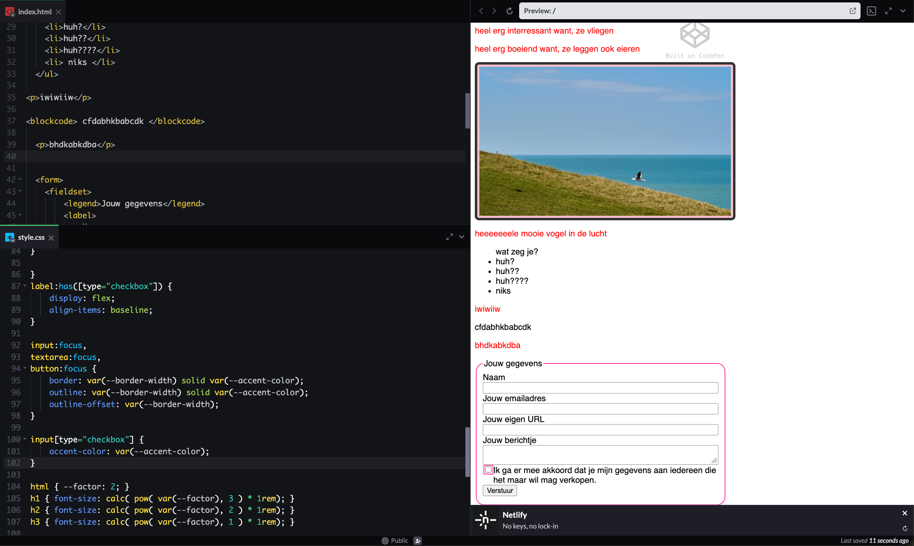

    /*Sprint 0 - Getting a grip*/

    9 nov, 2026

Leg uit wat een source hosting platform is en voor welke jij gekozen hebt. = Github, is een platform waaruit ik mijn domein code kan hosten, en ik heb gekozen voor deze omdat school het zei.
Vertel welke domeinnaam jij gekozen hebt en hoe je die hebt gekoppeld aan jouw pagina. = Ik heb gekozen voor JOQU, ik heb die gekoppeld door op github de daam te veranderen en op transip de domein naam te kopen en de ip adressen te koppelen aan mijn github ip's
Beschrijf hoe je aanpassingen aan jouw pagina kunt maken en hoe je er voor zorgt dat die op het web gepubliceerd worden. = Ik kan het aanpassen in VSCodium en als ik het daar opsla dan word het automatisch door gevoerd en gepubliceerd naar mijn domein pagina.

    11 nov, 2026

We hebben uitleg gehad over het web en waar het uit bestaat en hoe alles samen werkt, wat wat doet en wat wij gaan doen. Daarnaast zijn we bezig geweest met css en hebben we gewerkt aan een lelijke website maken. Geleerd hoe je tekst zo kan maken dat het zich aanpast aan het scherm, want bepaalde font-sizes zijn te groot op een telefoon. Hier gebruike je dan een soort rekensom. Ook hebben we geleerd dat je bijvoorbeld een form kan laten ordenen door display:fles te gebruiken.

We hebben uitleg gehad over @font-face. Wat je het beste kan doen en hoe je het moet gebruiken.

13 nov, 2026

Vandaag was nicky ziek, dus heb ik thuis schetsen gemaakt van een take-out menu design voor een tablet of een website.

(images/takeout.png)

16 nov, 2026

Een digital garden is een groeiende website, die constant verandert en geen eind website heeft, je kan er verkennen en ontdekken wat de geene die het heeft gemaakt erop heeft gezet. Een reguliere website is heel straight-forward en heeft een duidelijk doel en is al compleet en zal niet zomaar veranderen.

Wat een website webby maakt is wat jij leuk vind. of tof vind. wat voor animaties of wat voor fonts ofzo.

Ik wil aan de slag gaan met het maken van een soort digital archief, wat allemaal temaken heeft gamen en muziek. Ook lijk het me leuk om een soort van mijn huis, na te maken met al mijn hobby's en eastereggs.

Mix van mysims maken met mijn hobbies. Een soort van mysims wereld. die overloopt in dead by daylight, en dayz en gta.
