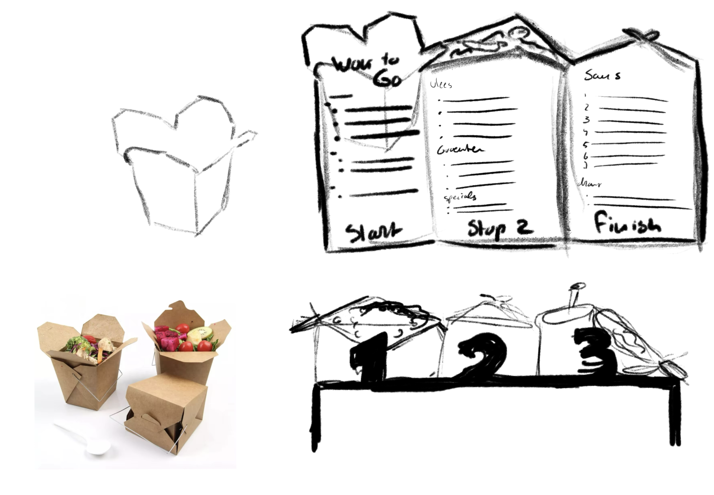
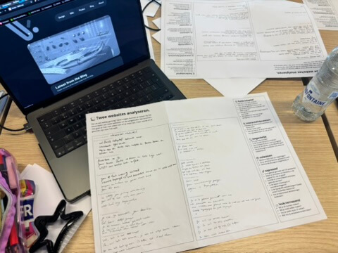
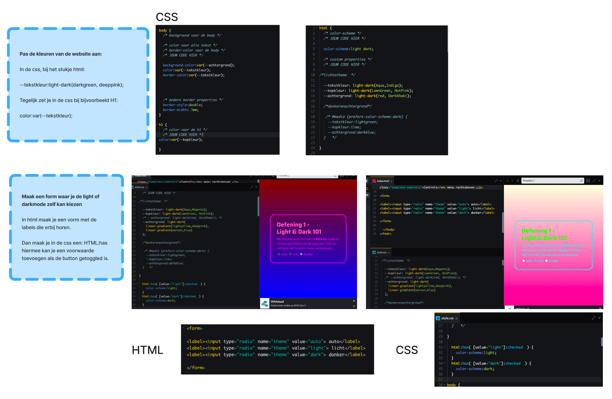
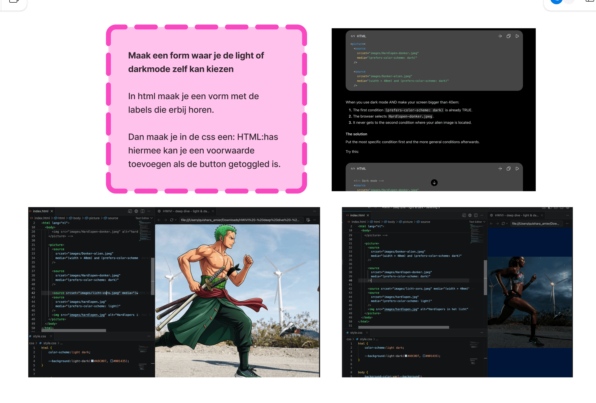
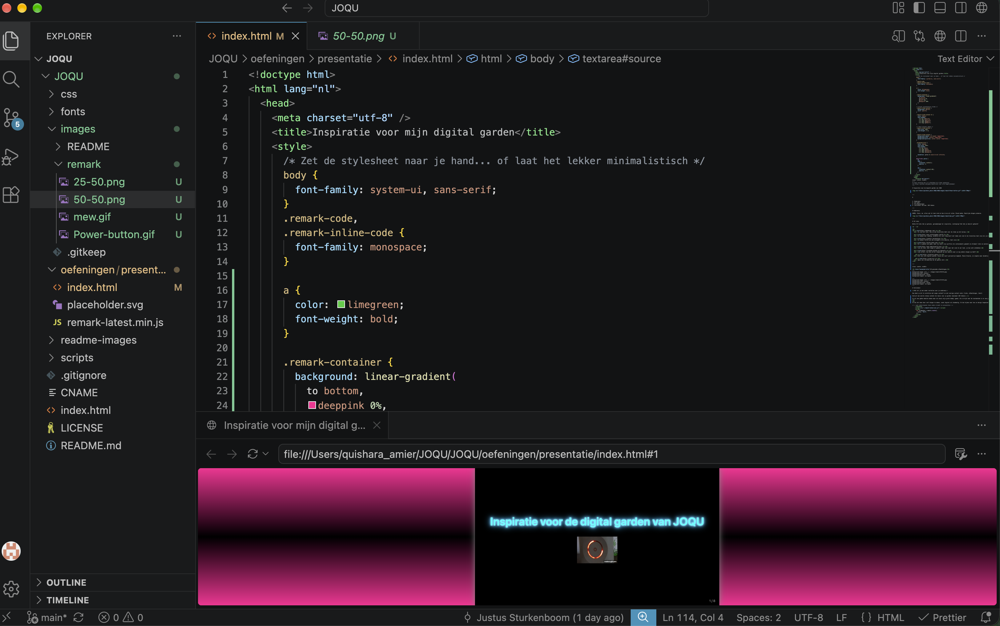
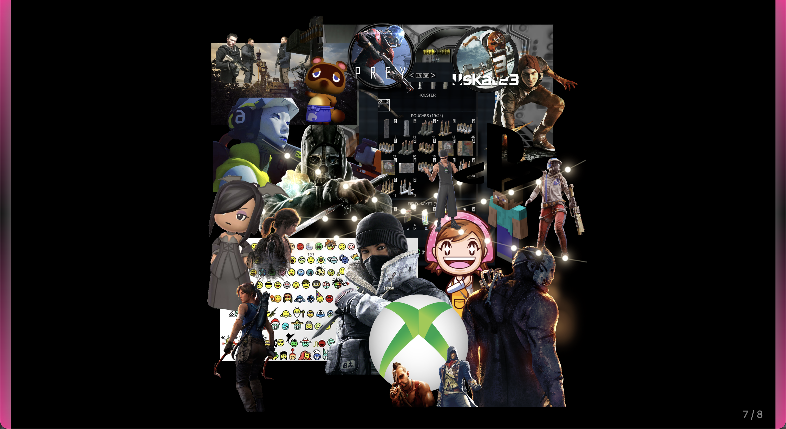

<h1> 9 nov, 2026 </h1>

Leg uit wat een source hosting platform is en voor welke jij gekozen hebt. = Github, is een platform waaruit ik mijn domein code kan hosten, en ik heb gekozen voor deze omdat school het zei.
Vertel welke domeinnaam jij gekozen hebt en hoe je die hebt gekoppeld aan jouw pagina. = Ik heb gekozen voor JOQU, ik heb die gekoppeld door op github de daam te veranderen en op transip de domein naam te kopen en de ip adressen te koppelen aan mijn github ip's
Beschrijf hoe je aanpassingen aan jouw pagina kunt maken en hoe je er voor zorgt dat die op het web gepubliceerd worden. = Ik kan het aanpassen in VSCodium en als ik het daar opsla dan word het automatisch door gevoerd en gepubliceerd naar mijn domein pagina.

  <h1>  11 nov, 2026 </h1>

We hebben uitleg gehad over het web en waar het uit bestaat en hoe alles samen werkt, wat wat doet en wat wij gaan doen. Daarnaast zijn we bezig geweest met css en hebben we gewerkt aan een lelijke website maken. Geleerd hoe je tekst zo kan maken dat het zich aanpast aan het scherm, want bepaalde font-sizes zijn te groot op een telefoon. Hier gebruike je dan een soort rekensom. Ook hebben we geleerd dat je bijvoorbeld een form kan laten ordenen door display:fles te gebruiken.

We hebben uitleg gehad over @font-face. Wat je het beste kan doen en hoe je het moet gebruiken.

<h1>13 nov, 2026 </h1>

Vandaag was nicky ziek, dus heb ik thuis schetsen gemaakt van een take-out menu design voor een tablet of een website.

<h1>16 nov, 2026</h1>

Een digital garden is een groeiende website, die constant verandert en geen eind website heeft, je kan er verkennen en ontdekken wat de geene die het heeft gemaakt erop heeft gezet. Een reguliere website is heel straight-forward en heeft een duidelijk doel en is al compleet en zal niet zomaar veranderen.

Wat een website webby maakt is wat jij leuk vind. of tof vind. wat voor animaties of wat voor fonts ofzo.

Ik wil aan de slag gaan met het maken van een soort digital archief, wat allemaal temaken heeft gamen en muziek. Ook lijk het me leuk om een soort van mijn huis, na te maken met al mijn hobby's en eastereggs.

Mix van mysims maken met mijn hobbies. Een soort van mysims wereld. die overloopt in dead by daylight, en dayz en gta.

<h1>17 nov, 2026</h1>

<h2> PRACTICUM 1 </h2>

Ik heb vandaag het practicum Light & Darkmode gedaan. Hier heb ik geleerd hoe je een light en darkmode kan toevoege, en hoe je het automatisch kan laten mee gaan met wat je ingesteld hebt op je computer. Ook hebben we geleerd hoe je afbeeldingen kan mee laten veranderen met de website grote in combinatie met de light en dakrmode (responsive afbeeldingen).

<h2>REMARK</h1>

Dit heeft me in zijn geheel veel te veel tijd gekost lol. Ik ben zomaar extra random dingen gaan doen HAH. uiteindelijk opzich wel grappig geworden, gelukkig. slay

<h1>18 nov, 2026</h1>

<h2>REMARK vragenlijst</h2>

<h3>Eigen verbinding:​</h3>

Wat is voor jou de essentie van wat je hebt gepresenteerd qua onderwerp en geschreven/beeldende content? ​
-- Echt een collectie van eigen hobby's en beelden die ik tof vind, op 1 pagina. Druk en van alles wat, met eastereggs. Het main onderwerp is wel gamen, maar ook dat het echt een ontdek website is.

Heeft 'de ander' een aanvulling op je onderwerp?​
-- spelen met de pointer. en consoles toevoegen.

Wat is het karakter/ de uitstraling/ het gevoel dat bij het onderwerp past? (bijv. stoer, hip, vrolijk, dynamisch, eenvoudig, enz.)​
-- Denk misschien hip, en dynamisch, gamer dungeon vibes, maar ook girly en grafisch.

Welke inspiratie kun je uit je 25 afbeeldingen halen. Stijl, een gevoel, vorm, enz.​
-- game inspiratie, wat voor stijl ze hebben en welke ik kan gebruiken in mijn website. Van het andere deel kan ik insipratie pakken van echte vormgeving voor op mijn website, en kleur en elementen.
--
​

<h3>Een stip op de horizon​</h3>

Wat zou je willen vertellen over het onderwerp aan een ander? en hoe zou je dat voor je kunnen zien? middels welke beeld, tekst, animatie, inhoudelijke content? (bijv. Ik wil voornamelijk afbeeldingen tonen, als een soort Pinterest, of ik wil muziek fragmenten laten horen, of ik gebruik korte teksten met eigen foto's). ​

Vul deze zin aan:
Ik wil mijn Digital Garden laten gaan over Quishara's brain specifiek, Game lair, design brain en random extra shit die ik cool en leuk vind. totale creatieve vrijheid. Een soort explore my brain.
en wil dat laten zien door alles wat met gamen en mijn brein te maken heeft aan content te tonen.
Ik begin met een stukje eigen content over wie ik ben en hoe ik op deze onderwerpen ben gekomen. ​
Als het begin is gemaakt kan ik mijn Garden verder uitbreiden door van alles en nog wat toe te voegen aan mijn website, niet met specifieke volgorde. Spelen met css en html en buttons die bijvoorbeeld de hele website veranderen.​
